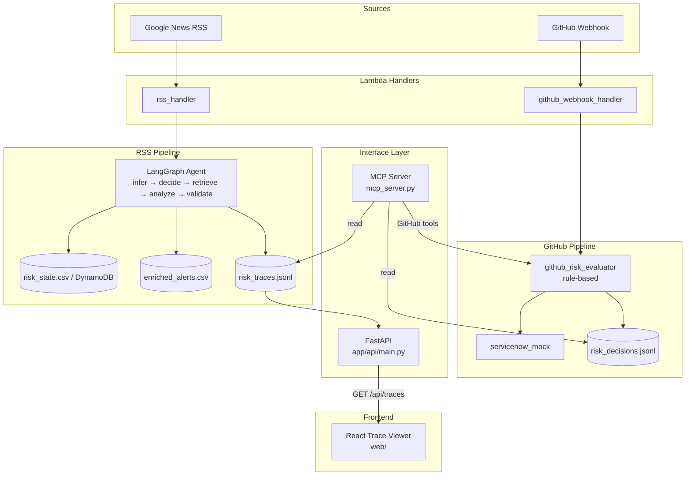
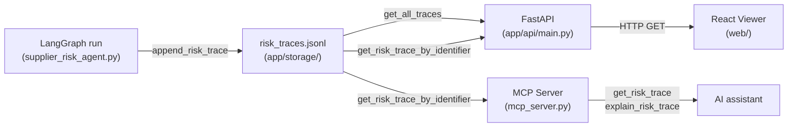

# Architecture

## System Purpose

This project is a **supply chain risk monitoring system**. It watches two classes of signal and turns them into structured risk decisions:

1. **Supplier disruption news** — Google News RSS headlines about key hardware suppliers (TSMC, Foxconn, Murata) are processed through an LLM-powered LangGraph agent and emitted as enriched risk alerts.
2. **Software supply chain events** — GitHub push and pull-request webhooks are evaluated by a rule-based scorer; high-risk events trigger a mock ServiceNow change ticket.

A **risk trace observability layer** records per-node timing and decisions for every LangGraph run. Traces are exposed via a FastAPI HTTP layer and a React trace viewer, and are also queryable through MCP tools.

---

## Current Architecture



---

## Repository Layout

```
app/
  api/
    main.py                   # FastAPI app — trace HTTP endpoints
  ingestion/
    rss_ingestion.py          # Fetches Google News RSS; returns raw headline dicts
    github_webhook_receiver.py # Verifies HMAC, normalizes GitHub payload, calls evaluator
  integrations/
    servicenow_mock.py        # Returns a fake ServiceNow CHANGE ticket dict
  storage/
    supplier_risk_state_store.py # Supplier risk state (RSS pipeline): RiskStateStore, CSV / DynamoDB backends
    checkpoint_store.py       # DynamoCheckpointSaver: durable LangGraph checkpoints (checkpointed lifecycle only)
    risk_state_store.py       # GitHub decision ledger: appends / queries risk_decisions (JSONL / DynamoDB)
    risk_trace_store.py       # Risk trace audit log: appends / queries risk_traces (JSONL / DynamoDB); build_trace_explanation
    supplier_graph.json       # Knowledge graph: [source, relation, target] triples
    supplier_profiles.json    # Text profiles for FAISS vectorstore
  workflows/
    supplier_risk_agent.py    # LangGraph agent (RSS pipeline); build_app(checkpointer=None)
    risk_workflow.py          # Checkpointed START / RESUME lifecycle over the same graph
    github_risk_evaluator.py  # Rule-based risk scorer (GitHub pipeline)
  workers/
    risk_worker.py            # Runtime-neutral START / RESUME / session CLI for containers and plain Python
  governance/
    authority.py              # Durable runtime authority (ACTIVE / REVOKED, versioned) per scope
    action_ledger.py          # Action ledger + gate: transactional authority check and claim; fail-closed gate
    authority_cli.py          # Operator CLI: show / revoke / restore

handlers/
  rss_handler/handler.py           # Lambda entry point for RSS pipeline
  github_webhook_handler/handler.py # Lambda entry point for GitHub webhooks

docker/
  worker.env       # Container runtime config mirroring the Lambda env (no credentials)

mcp_server.py    # FastMCP server — GitHub pipeline tools + risk trace tools

web/             # Vite + React + TypeScript trace viewer
  src/
    App.tsx        # Two-pane trace list / detail UI
    api.ts         # Fetch wrappers; parse responses through Zod schemas before returning
    types.ts       # Zod schemas (TraceSummary, TraceDetail, TraceStep); TypeScript types inferred from schemas
    types.test.ts  # Vitest contract tests: valid payloads pass, malformed payloads throw at schema boundary
```

---

## Developer Workflow

```bash
# Install Python dependencies
uv sync

# Add a new Python package
uv add <package>

# Run the RSS pipeline locally (requires OPENAI_API_KEY)
uv run python -m app.workflows.supplier_risk_agent

# Start the FastAPI server
uv run uvicorn app.api.main:app --reload

# Start the MCP server
uv run python mcp_server.py

# Start the React trace viewer (separate terminal, from web/)
cd web && npm run dev
```

`requirements.txt` is kept for Lambda Docker builds. `uv` manages the local `.venv`.

---

## Pipeline 1 — RSS Supplier Risk

### Trigger

AWS EventBridge invokes `handlers/rss_handler/handler.py` on a schedule. Events that carry an `action` key are routed to the checkpoint lifecycle instead (see [Lambda durability experiment](#lambda-durability-experiment-phase-3a3)); every other event runs the pipeline below. Locally: `uv run python -m app.workflows.supplier_risk_agent`.

### Request Flow

```
EventBridge (schedule)
  → rss_handler.lambda_handler
    → run_supplier_risk_flow()
      → bootstrap_alerts_csv_from_rss()   # fetch RSS, deduplicate, append to alerts.csv
      → for each "new" alert (up to MAX_ALERTS_PER_RUN):
          → is_actionable_alert()          # keyword pre-filter (no LLM call)
          → if not actionable: append_risk_trace(trace_steps=[])  → skip
          → generate trace_id (uuid4 hex)
          → LangGraph app.invoke()         # 6-node agent; nodes write to trace_steps
          → compare_and_update_risk_state() # detect escalation/suppression
          → append_risk_trace(...)         # persist to risk_traces.jsonl
      → write_enriched_alerts()           # append to enriched_alerts.csv
      → risk_store.flush()               # persist risk state to CSV or DynamoDB
  → return { statusCode: 200, body: summary_json }
```

### LangGraph Agent

The agent is a compiled `StateGraph` with six nodes:

```
infer → decide ──retrieve──► analyze → validate ──end──► END
                └──skip──────►         └──fallback──► fallback → END
```

| Node | What it does | Records in trace |
|---|---|---|
| `infer` | Maps headline to candidate suppliers via graph traversal and alias matching | timing only |
| `decide` | LLM call — returns `"retrieve"` or `"skip"` | timing + decision |
| `retrieve` | Calls the configured retriever backend (FAISS or Bedrock KB) | timing only |
| `analyze` | LLM call — returns structured JSON alert | timing; error if parse fails |
| `validate` | Checks required fields; routes to `fallback` on failure | timing + `"valid"` or `"fallback"` |
| `fallback` | Replaces alert with a safe `inconclusive` sentinel | timing only |

Each node records its own `started_at`, `ended_at`, `duration_ms`, and optional `decision` / `error` into `state["trace_steps"]` before returning.

**Module-level initialization**: `supplier_risk_agent.py` instantiates the LLM and retriever at import time. The FAISS index (built lazily on the first `retrieve`) uses `EMBEDDING_PROVIDER`: `openai` (default; `OpenAIEmbeddings`, needs `OPENAI_API_KEY`) or `bedrock` (Titan Text Embeddings V2, `amazon.titan-embed-text-v2:0`, in-Region only, using the default AWS credential chain). The Lambda sets `bedrock` because it has no OpenAI key. Neither is used when `RETRIEVER_PROVIDER=bedrock_kb`.

### Risk State Change Types

After the agent runs, `compare_and_update_risk_state` compares the new alert against the persisted state for `(supplier, risk_type)`:

| Type | Condition |
|---|---|
| `new_alert` | No prior state for this supplier/risk_type pair |
| `escalated` | New risk level is higher than prior |
| `suppressed` | Same risk level as prior (duplicate) |
| `downgraded` | New risk level is lower than prior |
| `inconclusive` | Alert status is not `"ok"`, or fields are missing |
| `ignored` | Headline failed the pre-filter; no LangGraph run |

---

## Pipeline 2 — GitHub Webhook Risk Evaluator

### Trigger

GitHub sends `push` and `pull_request` webhook events to the Lambda Function URL exposed by `handlers/github_webhook_handler/handler.py`.

### Request Flow

```
GitHub webhook (POST to Lambda Function URL)
  → github_webhook_handler.lambda_handler
    → process_github_webhook(event)
      → verify HMAC-SHA256 signature (X-Hub-Signature-256)
      → normalize payload → { event_type, repository, push|pull_request, ... }
      → evaluate_github_event_risk(normalized)    # rule-based, no LLM
      → if decision ∈ {review_recommended, manual_review_required}:
          → create_servicenow_ticket()             # mock only
  → return { statusCode: 200, normalized_event, decision, ticket }
```

Note: the webhook handler does **not** persist decisions to `risk_decisions.jsonl`. Persistence is handled only by the MCP server.

### Risk Score Rules

| Event | Branch / Target | Decision | Score |
|---|---|---|---|
| `push` | `refs/heads/main` | `manual_review_required` | 80 |
| `push` | `refs/heads/release/*` | `manual_review_required` | 85 |
| `push` | other | `allow` | 20 |
| `pull_request` | `main` | `review_recommended` | 60 |
| `pull_request` | `release/*` | `manual_review_required` | 75 |
| `pull_request` | other | `allow` | 25 |
| other event type | — | `ignore` | 0 |

---

## Risk Trace Observability

Every call to `process_alert_row` produces one trace record, written according to `TRACE_STORE_BACKEND`: `app/storage/risk_traces.jsonl` (`jsonl`, default) or the DynamoDB table named by `RISK_TRACES_TABLE` (`dynamodb`, default `risk_traces`).

### What is captured

- `alert_id` + `trace_id` — stable identifiers threaded through the entire run
- `headline`, `created_at`, `run_duration_ms` — run-level metadata
- `tool_decision`, `final_status`, `supplier`, `risk_type`, `risk_level`, `change_type` — outcome fields
- `trace_steps` — list of per-node records, each with `node_name`, `started_at`, `ended_at`, `duration_ms`, and optionally `decision` or `error`

For alerts that fail the `is_actionable_alert` pre-filter, `trace_steps` is `[]` and `change_type` is `"ignored"`.

### Where traces flow



---

## MCP Server

`mcp_server.py` runs a FastMCP server (`supply-chain-risk`). It is a separate process, not invoked by the Lambda handlers.

### Tools

**GitHub pipeline tools**

| Tool | Description |
|---|---|
| `evaluate_github_event_risk` | Calls the rule-based evaluator and persists the decision to `risk_decisions.jsonl` |
| `get_recent_risk_decisions` | Returns the N most recent decisions from `risk_decisions.jsonl` (default 20) |
| `get_decisions_requiring_review` | Returns decisions with `manual_review_required` or `review_recommended` (default 10) |
| `create_mock_servicenow_ticket` | Creates a mock ServiceNow ticket for a prior decision and persists the result |

**Risk trace tools**

| Tool | Description |
|---|---|
| `get_risk_trace` | Returns the raw trace record for an `alert_id` or `trace_id`; includes `matched_by` field |
| `explain_risk_trace` | Returns a human-readable explanation: outcome, node sequence, slowest node, decisions, errors |

Start with: `uv run python mcp_server.py` (blocks on stdin waiting for an MCP client).  
Test interactively: `npx @modelcontextprotocol/inspector uv run python mcp_server.py`

---

## FastAPI Layer

`app/api/main.py` exposes trace data over HTTP. CORS is enabled for `http://localhost:5173` (Vite dev server).

| Endpoint | Response |
|---|---|
| `GET /health` | `{"status": "ok"}` |
| `GET /api/traces` | Summary list (alert_id, trace_id, headline, final_status, created_at, run_duration_ms), newest first |
| `GET /api/traces/{identifier}` | Full trace record; matches `alert_id` or `trace_id`; 404 on miss |
| `GET /api/traces/{identifier}/explanation` | `{"explanation": "<text>"}` using `build_trace_explanation` |

Start with: `uv run uvicorn app.api.main:app --reload`

---

## API Contract Enforcement

The boundary between the FastAPI backend and the React frontend is treated as an explicit contract enforcement point. Every API response is validated against a declared schema at the moment it crosses that boundary, before it reaches any React component.

### Response validation flow

```
FastAPI
   ↓
JSON Response (untyped bytes)
   ↓
Zod Runtime Validation          ← enforced in web/src/api.ts
   ↓
Typed React Components
```

### Compile-time vs runtime contracts

TypeScript interfaces describe the shape a developer *intends* a value to have. They are erased at compile time and cannot detect divergence between what the backend serializes and what the frontend expects to receive.

Runtime contracts — schemas enforced as data crosses a system boundary — catch actual payload deviations: renamed fields, changed types, dropped array elements, unexpected nulls, or string-encoded numbers. In a system where the backend is Python and the frontend is TypeScript, no compiler bridges that gap. The two type systems are independent; only an executable check at the wire boundary provides a guarantee.

For a system with multiple autonomous components, this distinction is operationally significant. The LangGraph agent, the risk trace store, the FastAPI serializer, and the React viewer each carry their own data model. A change to how `trace_steps` are written in `risk_trace_store.py` will not produce a TypeScript error in `web/src/types.ts`. Without a runtime contract, that divergence surfaces silently as a render failure or incorrect data in the UI. Executable schemas at system boundaries convert silent drift into loud, located errors with field-level diagnostics.

### Design Decision

**Problem**: Trace records flow through the LangGraph agent, the risk trace store, FastAPI JSON serialization, and HTTP fetch parsing before reaching React components. Any layer can change — through a backend refactor, a newly optional field, or a serialization edge case — without triggering a compile error in the frontend. The distance between the backend Python data model and the frontend TypeScript types is invisible to the build system.

**Decision**: Define the frontend's expected shape as executable Zod schemas in `web/src/types.ts`. Derive TypeScript types from those schemas using `z.infer<>`, so the compile-time and runtime representations share a single definition and cannot drift from each other. In `web/src/api.ts`, parse every API response through its schema before returning it to the caller. Failures throw `ZodError` with the field path and expected type, surfacing contract violations at the boundary rather than inside component logic.

**Benefits**:
- Contract violations are located at the API boundary, not buried in render or display logic
- Error messages name the specific field path and the type mismatch, which shortens diagnosis across Python/TypeScript component boundaries
- TypeScript types cannot diverge from what is actually validated — one definition produces both
- Schemas are testable in isolation: representative and malformed payloads can be asserted against without starting the backend (`web/src/types.test.ts`)
- Governed and observable: when a backend field changes, the failure is explicit, repeatable, and attributable

**Tradeoffs**:
- Parse cost per response: negligible at this payload size; a concern only if response volume grows significantly
- Unknown keys are silently stripped by default. If the backend adds a field before the schema is updated, that field is discarded rather than forwarded. Use `.passthrough()` to preserve unknown keys; use `.strict()` to reject them and enforce a tighter contract

---

## React Trace Viewer

`web/` is a Vite + React + TypeScript app. Start with `cd web && npm run dev`.

### UI Layout

Two-pane split:

- **Left pane** — `TraceList`: shows all traces from `GET /api/traces`. Each row displays `alert_id`, `final_status` badge, `run_duration_ms`, and `created_at`. Clicking a row loads the detail pane.
- **Right pane** — `TraceDetailPanel`: shows headline, full metadata, node sequence with per-node timing (slowest node highlighted), decisions table, error table if any, and the explanation text from `GET /api/traces/{id}/explanation`.

### Schemas and Types (`src/types.ts`)

The file defines four Zod schemas. TypeScript types are inferred from the schemas via `z.infer<>`, so the compile-time type and the runtime validator share a single definition.

| Schema | Validates |
|---|---|
| `TraceSummarySchema` | One row in the `GET /api/traces` list response |
| `TraceStepSchema` | One entry in `trace_steps`; `decision` and `error` are optional |
| `TraceDetailSchema` | Full `GET /api/traces/{id}` response, including the `trace_steps` array |
| `ExplanationResponseSchema` | `GET /api/traces/{id}/explanation` wrapper `{ explanation: string }` |

Exported types (`TraceSummary`, `TraceStep`, `TraceDetail`) are derived from the schemas and used throughout `App.tsx`.

### Data Fetching (`src/api.ts`)

Three fetch wrappers: `fetchTraces()`, `fetchTraceDetail(identifier)`, `fetchExplanation(identifier)`. All target `http://localhost:8000`. Each wrapper parses the HTTP response body through its Zod schema before returning; a `ZodError` is thrown if the payload does not conform. See [API Contract Enforcement](#api-contract-enforcement) for the rationale.

### Contract Tests (`src/types.test.ts`)

Vitest unit tests exercise the schemas directly, without a running backend. The test suite verifies:

- Representative valid payloads for `GET /api/traces` and `GET /api/traces/{id}` parse successfully
- `run_duration_ms` returned as a string (a common Python serialization edge case) throws at the schema boundary
- A `trace_steps` item missing a required field (`duration_ms`) throws at the schema boundary
- `trace_steps: null` throws, catching the case where an array field is changed to a nullable scalar

Run with: `cd web && npm test`

---

## Checkpointed Workflow Lifecycle

`app/workflows/risk_workflow.py` runs the graph with durable checkpoints so a workflow can pause in one process and continue in another. It compiles the governed variant, `build_app(checkpointer, action_gate=...)`, which adds the privileged `act` node after `validate` (see [Runtime authority and governed actions](#runtime-authority-and-governed-actions-phase-3d)). The Lambda reaches it only through explicit `checkpoint_start` / `checkpoint_resume` actions. The Phase 2 path (`run_pipeline` → `process_alert_row`) is unchanged: it is uncheckpointed and has no `act` node.

**Identity**
- `thread_id` (`thread-<uuid>`) identifies the durable workflow and is the checkpoint key.
- `trace_id` identifies one execution attempt. START and every RESUME get a new one, so one thread has one trace record per attempt.

**Operations** (both take an explicit `checkpointer` and `risk_store`, plus a keyword-only `action_gate` dependency; both invoke with `durability="sync"`)

| Call | Behavior | Outcome `status` |
|---|---|---|
| `start_workflow(row, pause_before=None)` | New `thread_id` and `trace_id`, run until pause or END | `paused`, `completed`, `authority_denied`, or `ignored` (pre-filtered headline, no thread) |
| `resume_workflow(thread_id)` | No checkpoint → stop. Already at END → stop. Otherwise stamp a new `trace_id` into state and `invoke(None)` | `not_found`, `already_completed`, `paused`, `completed`, `authority_denied` |

RESUME takes no workflow input, so a completed thread can't be restarted by passing new input to `invoke`. Omitting `action_gate` doesn't skip governance: it denies every privileged action (fail closed).

**Settlement.** After each invoke, `app.get_state(config).next` decides the outcome before any business write:
- **Non-empty `next`, paused.** No `compare_and_update_risk_state` call. A trace is written with `workflow_event="paused"` and `change_type=null`.
- **Empty `next`, completed.** `finalize_completed_run` (shared with `process_alert_row`) updates supplier state and writes a trace with `workflow_event="started_completed"` or `"resumed_completed"`, including the action fields when `act` ran.
- **`act` refused by authority.** The invoke raises `AuthorityDenied`. No business write happens, the thread stays at `next=["act"]`, and a trace is written with `workflow_event="authority_denied"`.

Outcomes also carry `action_id`, `action_status` and `authority_version` (all `null` when no governed action was reached).

**Checkpoint table** (`DynamoCheckpointSaver`): PK `thread_id`, SK `sk`.
- Checkpoint items are `chk#{ns}#{checkpoint_id}` and hold the whole serialized checkpoint.
- Pending writes are `wr#{ns}#{checkpoint_id}#{task_id}#{idx}`.
- Values are serialized with LangGraph's serializer (msgpack) and stored as DynamoDB binary.
- Reads are strongly consistent. The latest checkpoint is the highest `chk#` sort key, because checkpoint IDs are uuid6.
- Only the sync API is implemented: `get_tuple`, `put`, `put_writes`, thread-scoped `list`, and `delete_thread`.

**Guarantees and limits**
- **Durable continuation with at-least-once node execution.** A node interrupted mid-run (for example an LLM call) runs again on resume.
- **Not exactly-once between graph completion and business state.** If the process dies after the graph reaches END but before supplier state is written, the checkpoint already shows completion. RESUME then returns `already_completed` and that state write is lost.
- **No protection against concurrent RESUME of the same thread.** Two executors can both run `analyze` and both apply the supplier state write, and `compare_and_update_risk_state` is not idempotent. (The action ledger does stop the governed action itself from being claimed twice; see Phase 3D.)
- **`executor_id` is audit only** (`AWS_LAMBDA_LOG_STREAM_NAME`, or `host:pid` locally). A warm Lambda environment can run several attempts.
- **Not handled yet:** checkpoint TTL/cleanup, batching checkpoint writes (one run is roughly 80 `PutItem` calls), a concurrency lease, and the audit gap when a resume fails after the new `trace_id` is stamped.

### Lambda durability experiment (Phase 3A3)

The RSS Lambda accepts two explicit actions in addition to its normal events:

| Event | Effect | Response `statusCode` |
|---|---|---|
| `{"action": "checkpoint_start", "headline": "..."}` | `start_workflow({"headline": ...}, pause_before=["analyze"])` | 200 (`paused`, or `completed`/`ignored`) |
| `{"action": "checkpoint_resume", "thread_id": "thread-<32 hex>"}` | `resume_workflow(thread_id)`. No other keys accepted: RESUME takes no workflow input | 200 (`completed`, `already_completed`, `paused`), 404 (`not_found`) |
| any other `action`, missing/extra keys, blank headline, malformed `thread_id` | rejected before any work | 400 |

The response body has `action`, `status`, `thread_id`, `trace_id`, `next`, `change_type`, `state_written`, `final_status`, `supplier`, `action_id`, `action_status`, `authority_version`, `executor_id`, `request_id`. An `authority_denied` outcome is also a 200. Logs: `checkpoint_action_start`, `checkpoint_action_complete`, `checkpoint_action_rejected`.

The handler code includes the Phase 3D gate, but the **deployed** Lambda still runs the pre-3D image (`sha256:a0500bbe…`, no `act` node). Its role and environment have no access to the governance tables. A Lambda built from current code would therefore deny every governed action (fail closed) until those are added.

- **Dependencies per invocation.** `DynamoCheckpointSaver(CHECKPOINT_TABLE)` and `get_risk_store()` are built fresh on every action, so continuity comes only from DynamoDB and `thread_id`. A missing `CHECKPOINT_TABLE` is a configuration error (the invocation fails); it is not a 4xx.
- **Infrastructure.** Table `risk_agent_checkpoints` (on-demand billing, PK `thread_id`, SK `sk`, no GSI, no TTL). The Lambda role has `dynamodb:Query` and `dynamodb:PutItem` on that table only (`RiskCheckpointAccess`), plus `bedrock:InvokeModel` on `amazon.titan-embed-text-v2:0` in us-west-2.
- **Experiment.** Invocation A runs `checkpoint_start` and the graph pauses before `analyze`. Invocation B runs `checkpoint_resume` with the returned `thread_id`. Evidence:
  - checkpoint items exist for the thread;
  - trace A has `workflow_event=paused` and trace B has `resumed_completed`;
  - both traces share the `thread_id` but have different `trace_id`s;
  - B's earlier-node timestamps match A's, so those nodes were not re-run;
  - supplier state is written only after B.
- **Executor identity.** Lambda may reuse a warm environment, so equal `executor_id`s don't weaken the result: RESUME reconstructs everything from DynamoDB.
- **Invoke synchronously with client retries disabled** (for example `AWS_MAX_ATTEMPTS=1` and a long `--cli-read-timeout`). An asynchronous invoke or a client retry can produce a duplicate START thread or a concurrent RESUME, which this design does not guard against.

### Container portability experiment (Phase 3C1)

**Worker.** `app/workers/risk_worker.py` is a thin command-line adapter over the same lifecycle the Lambda handler uses. It shares `START_PAUSE_BEFORE`, `THREAD_ID_PATTERN`, `OUTCOME_FIELDS` and `checkpoint_dependencies_from_env()` from `risk_workflow.py`; it duplicates no workflow logic.

```
python -m app.workers.risk_worker start  --headline "..."
python -m app.workers.risk_worker resume --thread-id thread-<32 hex>   # no other input accepted
python -m app.workers.risk_worker session                              # Phase 3D: long-lived, commands on stdin
```

`start` and `resume` print one JSON outcome line and exit with 0 (success), 2 (invalid arguments), 3 (`not_found`) or 4 (`authority_denied`, added in Phase 3D). `session` is described under Phase 3D.

Running it from the Lambda image needs an entrypoint override, because the image's default entrypoint is Lambda's bootstrap script:

```
docker run --rm --platform linux/amd64 --hostname c1-docker-worker \
  --entrypoint python --env-file docker/worker.env \
  -e AWS_ACCESS_KEY_ID -e AWS_SECRET_ACCESS_KEY -e AWS_SESSION_TOKEN \
  <image> -m app.workers.risk_worker resume --thread-id <thread_id>
```

`docker/worker.env` mirrors the Lambda environment and contains no credentials.

**Experiment: Lambda START, then local Docker RESUME, on one artifact.**

*Artifact*
- Code commit `3b18c1a`, image built for linux/amd64.
- Lambda and the local Docker container ran the same image digest: `sha256:a0500bbef2e4f5d1939b2d7815b37d2faa2f0f9ed065cbb2e9d11c8cb0a7b224`. Application code and LangGraph serialization versions were therefore identical in both executors.

*Lambda START* (`checkpoint_start`, headline `TSMC halts wafer production after earthquake in Taiwan [C1-demo-2026-10-11]`)

| Field | Value |
|---|---|
| `thread_id` | `thread-fa78851119384563a725219cee7707c4` |
| `trace_id` | `97c3b508f4fb4852b0b72cf5308e9c55` |
| `executor_id` | `2026/10/11/[$LATEST]6e43d61f20d746fdb801f3440f21b249` |
| `status` / `next` / `state_written` | `paused` / `analyze` / `false` |
| Nodes completed before the pause | `infer → decide → retrieve` (decide chose `retrieve`) |
| Checkpoint items for the thread | 5 `chk`, 48 `wr` |
| Supplier state for the headline | absent |

*Local Docker RESUME*
- The worker received only the `thread_id` as workflow input.
- Credentials were temporary ones exported from the `ken-ai-dev` profile.

| Field | Value |
|---|---|
| `trace_id` | `b703a840b5454ae296df306526cf6eff` |
| `executor_id` | `c1-docker-worker:1` |
| `status` / `final_status` | `completed` / `ok` |
| `change_type` / `state_written` | `suppressed` / `true` |
| `supplier` | `TSMC` |
| Nodes executed | `analyze → validate` (validate decision `valid`) |
| `workflow_event` | `resumed_completed` |

*The prefix was not re-run.* Trace B kept the original Lambda timestamps for the completed prefix, and Docker executed only the remaining nodes:

| Node | Executor | Started | Ended |
|---|---|---|---|
| `infer` | Lambda | 2026-10-11T20:51:37.553+00:00 | — |
| `decide` | Lambda | 2026-10-11T20:51:37.648+00:00 | 2026-10-11T20:51:38.241+00:00 |
| `retrieve` | Lambda | 2026-10-11T20:51:38.250+00:00 | 2026-10-11T20:51:46.472+00:00 |
| `analyze` | Docker | 2026-10-11T20:54:56.822+00:00 | 2026-10-11T20:54:59.341+00:00 |
| `validate` | Docker | 2026-10-11T20:54:59.486+00:00 | — |

*Business state after completion* (`supplier_risk_state`)
- `pk=TSMC#earthquake`, `supplier=TSMC`, `risk_type=earthquake`, `current_risk_level=High`
- `last_headline=TSMC halts wafer production after earthquake in Taiwan [C1-demo-2026-10-11]`
- `last_seen_at=2026-10-11T20:55:00+00:00`

*Completed-workflow idempotency*
1. A second Docker RESUME returned `already_completed` with `state_written=false`, reporting the same completed trace.
2. A later Lambda RESUME also returned `already_completed` with `state_written=false` and the same completed trace.
3. That Lambda call ran in a different Lambda executor: `2026/10/11/[$LATEST]3620a1481aae4cd99b60c56574778c0f`.

**Conclusion.** A LangGraph workflow started in AWS Lambda was durably checkpointed, resumed to completion by a separate local Docker executor using only its `thread_id`, and afterwards recognized as completed by both Docker and a different Lambda executor, without repeating the business-state write.

**What C1 does not show**
- Kubernetes or EKS portability (not tested).
- Exactly-once execution.
- Safe concurrent RESUME.
- Least-privilege credentials for the Docker worker.
- Kill-switch or authority revocation.

**Limitations that still apply**
- At-least-once node execution.
- The window between graph completion and the supplier-state write: a crash there loses the write.
- Concurrent RESUME of one thread is not protected.
- The Docker worker used temporary `ken-ai-dev` credentials for portability testing, not a dedicated least-privilege workload identity.

### Runtime authority and governed actions (Phase 3D)

The checkpointed workflow can perform one privileged action, and an operator can govern it through durable state outside the executor. **Revoking authority is not killing compute.** The executor keeps running. Its next attempt to perform a privileged action is refused, and the workflow stays durably parked at that action until authority is restored.

#### State separation

Each concern has its own durable store. None of them is derived from another, and none lives in the executor:

| Concern | Store | Key | Written by |
|---|---|---|---|
| Workflow progress | `risk_agent_checkpoints` (`DynamoCheckpointSaver`) | `thread_id` + `sk` | LangGraph, after every node |
| Business state | `supplier_risk_state` (`RiskStateStore`) | `{supplier}#{risk_type}` | `finalize_completed_run`, only after the graph reaches END |
| Action lifecycle and idempotency | `risk_agent_actions` (`app/governance/action_ledger.py`) | `action_id` | The `act` node, through the action gate |
| Authority | `risk_agent_authority` (`app/governance/authority.py`) | `scope_id` | The operator only (`authority_cli`); the agent only reads it |
| Audit | `risk_traces` (`risk_trace_store.py`) | `trace_id` | One record per execution attempt, including denials |

#### Governed-action boundary

The checkpointed graph adds one node, `act`, between `validate` and END:

```
… → analyze → validate ──ok + valid──► act → END
                       ├──inconclusive──► END
                       └──invalid──► fallback → END
```

- **Only `build_app(checkpointer, action_gate=...)` has `act`.** The module-level Phase 2 graph is unchanged and performs no privileged action.
- **`act` opens a review ticket** for a valid supplier-specific alert. It uses the mock ServiceNow `create_servicenow_ticket`, so there is no external system of record.
- **The action ID is deterministic:** `action#{thread_id}#open_review_ticket`. A re-run of `act`, after a denial or a crash, maps to the same ledger item. The ticket's `correlation_id` equals the action ID.
- **A denial produces no checkpoint for `act`.** `act` raises `AuthorityDenied`, so LangGraph saves no output from it, and the latest checkpoint keeps `next=("act",)`. Earlier nodes are not re-run. A later RESUME, by any executor and given only the `thread_id`, runs just `act`.
- **Supplier state is written only after `act` succeeds and the graph reaches END.** A denied workflow therefore leaves business state untouched.

#### Authority table (`risk_agent_authority`)

**Item shape:** `{scope_id, status: ACTIVE | REVOKED, version, reason, updated_by, updated_at}`. The agent's scope is fixed in code as `agent#supplier-risk-agent`; an executor can't choose its own scope through configuration.

**Changes and reads**
- **Who changes it:** only the operator CLI.
  ```
  python -m app.governance.authority_cli show
  python -m app.governance.authority_cli revoke  --reason "..." [--actor NAME]
  python -m app.governance.authority_cli restore --reason "..." [--actor NAME]
  ```
- **Versioning:** every change increments `version` with a conditional `UpdateItem`.
- **`restore` also serves as the initial grant:** it creates the item at version 1.
- **`revoke` never creates an item:** revoking an unknown scope is an error.
- **Reads** are strongly consistent `GetItem`s, made at every privileged action rather than cached per process.

**A missing item means not authorized.** The table is deliberately not seeded by Terraform, so a later `terraform apply` can never undo an operator's revocation.

#### Action ledger (`risk_agent_actions`)

**Statuses**
- `DENIED`: admission refused; the action can be admitted later.
- `IN_FLIGHT`: claimed; the effect may or may not have happened.
- `COMPLETED`: the effect is done and its result recorded.

**Admission is one DynamoDB transaction** (`TransactWriteItems`):
1. A `ConditionCheck` that the authority item is `ACTIVE` **at the version just read**.
2. An `Update` that moves the action to `IN_FLIGHT` (incrementing `attempt_count`), allowed only if the action is new or `DENIED`.

"Authority allowed it" and "this attempt claimed it" are therefore one atomic decision. A revocation between the authority read and the transaction cancels the claim. If authority was revoked and restored in that gap, admission retries against the newer version. The admitting `authority_version` is recorded on the action.

**After admission**
- The effect runs.
- `complete()` sets `COMPLETED` together with the effect's result, conditional on the item still being `IN_FLIGHT` and claimed by the same `trace_id`.

**Refusals and replays**
- **Revoked or missing authority:** the action is recorded as `DENIED` (`denied_authority_status`, `denied_authority_version`, `denied_count`, `denied_by_trace_id`, `denied_executor`), and `AuthorityDenied` is raised. Denial never downgrades an `IN_FLIGHT` or `COMPLETED` item. These denial fields are kept when the action is later admitted.
- **Already `COMPLETED`:** the stored result is returned (`replayed=true`) and the effect does not run again.
- **Already `IN_FLIGHT`:** `ActionInFlight` is raised. An earlier claim never completed and needs reconciliation, which is not implemented, so the action is not re-executed.

#### Fail-closed configuration

- **Missing governance tables:** `checkpoint_dependencies_from_env()` builds the gate from `AUTHORITY_TABLE` and `ACTIONS_TABLE`. If either is unset, it returns a gate that denies every action with status `UNCONFIGURED`.
- **No gate passed to the lifecycle:** `start_workflow` / `resume_workflow` with no `action_gate` deny in the same way.
- **Why:** skipping the action instead would let an unconfigured executor bypass authority.
- **Missing authority item:** denied with status `MISSING`.

#### Revocation semantics

- **Revocation is prospective.** It governs the *next* admission. An effect already admitted (`IN_FLIGHT`) is not interrupted and is recorded with the version that admitted it.
- **Revocation does not stop compute.** Ungated work, such as `analyze`'s Bedrock call, still runs under revoked authority; only the privileged action is refused.
- **Terminating the executor is not a kill switch.** C1/C2 showed that any new executor can resume a workflow from its `thread_id`. Authority, not process lifetime, decides whether the action happens.

#### Executor interfaces

- **`risk_worker session`** is a long-lived executor. One process reads commands from stdin, one JSON object per line (`{"start": "<headline>"}` or `{"resume": "thread-…"}`), and prints one outcome line per command until EOF. Malformed lines produce an `error` line without ending the session. Dependencies are built once per session, so authority is shown to be re-read per action rather than cached per process.
- **`risk_worker start|resume`** exits with 4 on `authority_denied`.
- **The Lambda handler** returns `authority_denied` as a 200.

#### Infrastructure (`terraform/governance.tf`)

- **Tables:** `risk_agent_authority` (PK `scope_id`) and `risk_agent_actions` (PK `action_id`), both on-demand billing, with no GSI, streams or TTL.
- **No IAM change:** the Lambda role has no access to either table.
- **Container wiring:** the container worker gets `AUTHORITY_TABLE` and `ACTIONS_TABLE` as runtime `-e` overrides; `docker/worker.env` does not contain them.

#### Live experiment (Phase 3D3)

**Claim.** A single live agent executor was permitted to perform a governed action under ACTIVE authority, denied a subsequent action after authority was externally revoked without stopping or restarting the executor, and then resumed the denied workflow from the action boundary after authority was externally restored. Workflow progress, authority state, action state, and business state remained independently durable.

*Setup*

| Item | Value |
|---|---|
| Run ID | `3D3-20261011T224648Z` (evidence kept outside the repo) |
| Image | `risk-agent-3d3:6118769`, `sha256:8ff23cd319095ae81f1425663c648bed2c4ad0872798a04215dbe21cfed59161`, linux/amd64. Built from `6118769`, whose application code is the 3D1 commit `9adf6cc`. Local only: not pushed, not deployed |
| Executor P | One `docker run -i … --entrypoint python <image> -m app.workers.risk_worker session` with `--env-file docker/worker.env`, plus `-e AUTHORITY_TABLE=risk_agent_authority -e ACTIONS_TABLE=risk_agent_actions` |
| P's credentials | Temporary `ken-ai-dev` credentials passed by name only |
| Driving P | Commands written as single JSON lines to a named pipe. A separate holder process kept the pipe open; it was not part of the executor evidence |
| Operator | `authority_cli`, run from a separate host process with its own `ken-ai-dev` SSO session; it never touched P |
| Lambda | Not invoked; image digest `sha256:a0500bbe…` unchanged before and after |

*Sequence*

| Step | Actor | Result |
|---|---|---|
| Seed | Operator | MISSING v0 → **ACTIVE v1** (`2026-10-11T22:50:00.188Z`) |
| T1 START | P | `thread-6c64dae4e23948e3b2e9f4865fb835f1`: `paused`, `next=["analyze"]`, 5 checkpoints |
| T1 RESUME | P | `completed`, action `COMPLETED` under **v1**, ticket `MOCK-CHG-F85F1219`, `state_written=true` (`suppressed`). Checkpoints 5 → 9 (`update`, `analyze`, `validate`, `act`) |
| Revoke | Operator | ACTIVE v1 → **REVOKED v2** (`2026-10-12T00:48:54.256Z`). P unchanged before and after |
| T2 START | P | `thread-4fc91cb5fd9447d6b99ab6b5f1d49070`: `paused`, `next=["analyze"]`, 5 checkpoints |
| T2 RESUME | P | **`authority_denied`**, `next=["act"]`, action `DENIED` at **v2**, `state_written=false`. Checkpoints 5 → 8 (`update`, `analyze`, `validate`; no `act`). A separate read-only process confirmed `next=('act',)` with no `action_result` |
| Restore | Operator | REVOKED v2 → **ACTIVE v3** (`2026-10-12T00:51:09.249Z`). P unchanged before and after |
| T2 RESUME | P | `completed`, action `COMPLETED` under **v3**, ticket `MOCK-CHG-0D74B150`, `state_written=true`. Checkpoints 8 → **10** (`update`, `act` only) |
| T2 RESUME (repeat) | P | `already_completed`, `state_written=false`. No change anywhere |
| EOF | Holder closed | P exited with code 0 at `2026-10-12T00:53:49.916Z` |

*Same-executor evidence*
- **Container:** `c512d0a1cec3…`, host PID `94888`, started `2026-10-12T00:44:49.444Z`, `restarts=0`. It contained exactly one process (`python -m app.workers.risk_worker session`) from the first command to EOF.
- **Snapshots:** identical before and after every transition.
- **Executor identity:** all six responses and every ledger and trace record carry `executor_id=c512d0a1cec3:1` (Docker's default hostname is unique per container; Python ran as PID 1).
- **Health:** no error lines; stderr was empty.

*Supplier state (`TSMC#earthquake`, consistent reads)*

| Snapshot | `last_headline` | `last_seen_at` |
|---|---|---|
| Before T2, after T1 | `… [3D3-20261011T224648Z-T1]` | `2026-10-12T00:47:19+00:00` |
| After the v2 denial | **Identical item** (empty sorted full-item diff) | |
| After the v3 resume | `… [3D3-20261011T224648Z-T2]` | `2026-10-12T00:51:19+00:00` |
| After the repeat RESUME | Identical to the previous row | |

Supplementary: the number of items whose `last_headline` equals the T2 headline was 0 after the denial and 1 after the v3 resume.

*T2 traces* (all three carry T2's `thread_id`)
- **`7a0290e5…`:** `paused`; steps `infer`, `decide`, `retrieve`.
- **`a66ef86b…`:** `authority_denied`, `authority_status=REVOKED`, `authority_version=2`, `action_status=DENIED`; steps through `validate`, no `act`.
- **`472983ad…`:** `resumed_completed`, `authority_version=3`. Its `infer`…`validate` steps are identical to the denial trace's, timestamps included (`analyze` at 00:49:15.627, `validate` at 00:49:18.185). **Only `act`** (00:51:18.187) started after the trace's `created_at` (00:51:18.097).
- **The repeat RESUME** created no trace: 3 for T2, and 18 in the whole table, both unchanged.

*T2 action ledger item*
- `status=COMPLETED`, `attempt_count=1`, `authority_version=3`, `claimed_by_trace_id=472983ad…`.
- The retained denial record is byte-identical to its post-denial state: `denied_count=1`, `denied_authority_status=REVOKED`, `denied_authority_version=2`, `denied_by_trace_id=a66ef86b…`.
- `effect.ticket_id=MOCK-CHG-0D74B150`, with `correlation_id` equal to the action ID.
- After the repeat RESUME the item was byte-identical, including `updated_at`. The ledger holds exactly two actions with two distinct tickets.

*Exactly one effect.* The mock ticket has no external record, so the evidence is the ledger plus the claim-before-effect structure:
- The effect runs only after the transaction claims the action.
- `attempt_count=1` means exactly one claim.
- `COMPLETED`, with the effect's own ticket ID, means that claim's effect ran.
- A completed item can't be claimed again.

*Operational notes*
- **Credential lifetime:** P's credentials were checked for at least 45 minutes remaining. Fresh role credentials last about an hour, and P can't refresh them without restarting. The run took about 9 minutes.
- **Cleanup:** after the run, the container (and its stored environment) was removed. A fresh Terraform plan showed no changes, and the governance items, checkpoints and traces were kept as evidence.

**What 3D3 does not show**
- **Separation of duties.** The operator and the executor both used `ken-ai-dev` (AdministratorAccess), so the executor could have restored its own authority.
- **IAM-level enforcement.** Authority is enforced in application code; the executor's credentials could reach the tables or a ticketing API directly.
- **Revocation of an already-admitted action.** Revocation takes effect at the next admission.
- **Exactly-once execution.** At most one claim per `action_id` is enforced. A crash between the effect and `complete()` leaves the action `IN_FLIGHT`, with no recovery.
- **Compensation.** A completed effect stays completed after revocation.
- **Safe concurrent RESUME.** Two executors could still both run `analyze` and both write supplier state.
- **Protection against stale images.** An executor running pre-3D code (no `act` node), such as the deployed Lambda, could complete a governed thread without any authority check. This was not exercised.
- **Workload identity or EKS.** Not covered.
- **An external system of record for the effect.**

### Phase 3 status

Thesis: the workflow is stateful, the execution environment is disposable, and authority is independently governable.

- [x] A1: separate `thread_id` / `trace_id`, `build_app(checkpointer)`, in-process interrupt/resume
- [x] A2: `DynamoCheckpointSaver` and explicit START/RESUME lifecycle (proven under moto)
- [x] A3: AWS Lambda START → pause → later Lambda RESUME
- [x] C1: container runtime portability (Lambda START → local Docker RESUME, same image digest)
- [ ] Kubernetes: run the worker as a pod, and resume after a pod restart or replacement
- [ ] Workload identity for the worker (least privilege, no developer credentials)
- [x] 3D1: authority store, transactional action ledger, governed `act` node, fail-closed configuration, `session` worker (proven under moto)
- [x] 3D2: `risk_agent_authority` and `risk_agent_actions` tables (Terraform)
- [x] 3D3: live revoke/restore against one long-lived Docker executor (ACTIVE v1 allowed → REVOKED v2 denied at `act` → ACTIVE v3 resumed, only `act` ran → repeat RESUME no-op)
- [x] 3D4: Phase 3D documentation (reviewed)
- [ ] Separation of duties and IAM-level enforcement of authority (operator vs agent principals)

## Data Models and Storage

### LangGraph State (`RiskState`)

```python
class RiskState(TypedDict):
    alert_id: str
    thread_id: Optional[str]  # durable logical workflow; None on the Phase 2 path
    trace_id: str             # one execution attempt
    headline: str
    candidate_suppliers: List[str]
    context: str
    tool_decision: Optional[Literal["retrieve", "skip"]]
    alert: Optional[dict]
    is_valid: Optional[bool]
    trace_steps: List[dict]
    retriever_metadata: Optional[dict]  # set by retrieve; None when skipped
    action_result: Optional[dict]       # set by act (governed checkpointed graph only)
```

### LLM Alert Output (from `analyze` node)

```json
{
  "status": "ok" | "inconclusive",
  "supplier": "TSMC" | null,
  "risk_type": "earthquake" | "flood" | "strike" | "sanctions" | "outage" | "export_controls" | ...,
  "risk_level": "High" | "Medium" | "Low" | null,
  "impact": "...",
  "recommended_action": "...",
  "relevant_supplier_context": "..."
}
```

### Enriched Alert Row (`enriched_alerts.csv`)

`processed_at`, `alert_id`, `trace_id`, `trace_steps_count`, `headline`, `source`, `status`, `tool_decision`, `candidate_suppliers`, `final_status`, `supplier`, `risk_type`, `risk_level`, `change_type`, `change_message`, `impact`, `recommended_action`, `relevant_supplier_context`

### Risk Trace Record (`risk_traces.jsonl`)

One JSON object per line, appended by `append_risk_trace`:

```json
{
  "alert_id": "rss-1",
  "trace_id": "<uuid hex>",
  "headline": "...",
  "created_at": "<ISO-8601 UTC with ms>",
  "run_duration_ms": 4023.8,
  "tool_decision": "retrieve" | "skip",
  "final_status": "ok" | "inconclusive",
  "supplier": "TSMC" | null,
  "risk_type": "earthquake" | null,
  "risk_level": "High" | null,
  "change_type": "new_alert" | "escalated" | "suppressed" | "downgraded" | "inconclusive" | "ignored",
  "trace_steps": [
    {
      "node_name": "infer",
      "started_at": "<ISO-8601>",
      "ended_at": "<ISO-8601>",
      "duration_ms": 0.0
    },
    {
      "node_name": "decide",
      "started_at": "...", "ended_at": "...", "duration_ms": 934.9,
      "decision": "retrieve"
    }
  ]
}
```

For ignored alerts (pre-filter), `trace_steps` is `[]` and `run_duration_ms` is `0`.

Optional fields:
- `executor_id` is recorded on every run.
- `thread_id` and `workflow_event` are recorded only by the checkpointed lifecycle (`start_workflow` / `resume_workflow`). `workflow_event` is `paused`, `started_completed`, `resumed_completed` or `authority_denied`.
- `action_id`, `action_status` and `authority_version` are recorded when a governed action was reached. `authority_status` (`REVOKED`, `MISSING`, `UNCONFIGURED`) is recorded on `authority_denied` traces.
- The uncheckpointed Phase 2 path (`process_alert_row`) has no durable workflow, so it records neither field; `trace_id` is its only identity.

For a resumed attempt, `trace_steps` is the cumulative list from checkpoint state, while `run_duration_ms` covers only that attempt.

### Persistence Concerns

Separate stores in `app/storage/`, each with its own data model and configuration:

| Store | Module | Holds | Configured by |
|---|---|---|---|
| Supplier risk state | `supplier_risk_state_store.py` | Current state per `(supplier, risk_type)` (RSS pipeline) | `RISK_STATE_BACKEND`, `RISK_STATE_FILE`, `RISK_STATE_TABLE` |
| Decision ledger | `risk_state_store.py` | GitHub / software supply chain risk decisions | `DECISION_STORE_BACKEND`, `RISK_DECISIONS_TABLE` |
| Risk traces | `risk_trace_store.py` | Per-run audit trace of the LangGraph agent | `TRACE_STORE_BACKEND`, `RISK_TRACES_TABLE` |
| Workflow checkpoints | `checkpoint_store.py` | LangGraph execution progress per `thread_id` (checkpointed lifecycle only) | `CHECKPOINT_TABLE` (Lambda checkpoint actions) |
| Runtime authority | `app/governance/authority.py` | Operator-controlled `ACTIVE` / `REVOKED` state per scope, versioned | `AUTHORITY_TABLE` |
| Action ledger | `app/governance/action_ledger.py` | Lifecycle and idempotency of governed side effects per `action_id` | `ACTIONS_TABLE` |

Despite its name, `risk_state_store.py` is the GitHub decision ledger, not supplier risk state.

### Supplier Risk State

`app/storage/supplier_risk_state_store.py` is the only application code that reads or writes supplier risk state. `get_risk_store()` returns a `RiskStateStore` implementation selected by `RISK_STATE_BACKEND`:

- **`CsvRiskStateStore`** (`RISK_STATE_FILE`, default `risk_state.csv`): columns `supplier`, `risk_type`, `current_risk_level`, `last_headline`, `last_seen_at`. Loaded into memory on construction; written back by `flush()`.
- **`DynamoRiskStateStore`** (`RISK_STATE_TABLE`, default `supplier_risk_state`): same fields; PK = `{supplier}#{risk_type}`. Writes go straight to the table; `flush()` is a no-op.

Interface: `get(supplier, risk_type)`, `put(supplier, risk_type, row)`, `list_all()`, `flush()`.

The store is canonical current state: one row per `(supplier, risk_type)`. When the CSV is loaded, rows with an empty `supplier` or `risk_type` are skipped and the last duplicate wins, so `list_all()` returns one row per key.

Callers:
- RSS pipeline: `run_pipeline()` → `compare_and_update_risk_state()` (`get` / `put`) → `flush()`
- Planner copilot: `load_supplier_risk_rows()` → `list_all()`

### Risk Decision Record (`risk_decisions.jsonl`)

Written by `app/storage/risk_state_store.py` (JSONL locally, or the `RISK_DECISIONS_TABLE` DynamoDB table when `DECISION_STORE_BACKEND=dynamodb`).

```json
{
  "id": "<uuid hex>",
  "timestamp": "<ISO-8601 UTC>",
  "normalized_event": { "event_type": "...", "repository": "...", ... },
  "decision": { "decision": "...", "risk_score": 0, "reason": "..." },
  "ticket": { "ticket_id": "MOCK-CHG-...", ... } | null
}
```

### Supplier Knowledge Base

- `supplier_graph.json` — list of `[source, relation, target]` triples. Relations: `operates_in`, `depends_on`, `supplies`, `has_risk`. Covers TSMC, Murata, Foxconn.
- `supplier_profiles.json` — free-text profiles for each supplier; loaded into FAISS at startup.

---

## Environment Variables

| Variable | Default | Notes |
|---|---|---|
| `OPENAI_API_KEY` | — | Required when `RETRIEVER_PROVIDER=faiss` or `LLM_PROVIDER=openai`; not required on the Bedrock KB path |
| `LLM_PROVIDER` | `openai` | `openai`, `bedrock`, or `bifrost` |
| `OPENAI_MODEL` | `gpt-4o-mini` | Model name for OpenAI provider |
| `BEDROCK_MODEL_ID` | `us.anthropic.claude-haiku-4-5-20251001-v1:0` | Model ID for Bedrock provider |
| `BIFROST_MODEL_ID` | — | Model name passed through the Bifrost gateway when `LLM_PROVIDER=bifrost` (e.g. `bedrock/us.anthropic.claude-haiku-4-5-20251001-v1:0`) |
| `BIFROST_BASE_URL` | `http://localhost:8080/langchain` | Bifrost LangChain-compatible gateway endpoint |
| `BIFROST_API_KEY` | `dummy-key` | Placeholder key; Bifrost does not validate it |
| `RISK_STATE_BACKEND` | `csv` | `csv` or `dynamodb` |
| `RISK_STATE_FILE` | `risk_state.csv` | Path when backend is `csv` |
| `RISK_STATE_TABLE` | `supplier_risk_state` | DynamoDB table name |
| `OUTPUT_MODE` | `csv` | `csv` (writes local files) or `lambda` (skips file writes) |
| `MAX_ALERTS_PER_RUN` | `1` | Limits LLM calls per invocation |
| `GITHUB_WEBHOOK_SECRET` | — | HMAC secret for GitHub webhook signature verification |
| `RETRIEVER_PROVIDER` | `faiss` | `faiss` or `bedrock_kb` |
| `BEDROCK_KB_ID` | — | Required when `RETRIEVER_PROVIDER=bedrock_kb` |
| `BEDROCK_KB_TOP_K` | `4` | Number of results to request from the KB |
| `EMBEDDING_PROVIDER` | `openai` | FAISS embeddings: `openai` or `bedrock` (Titan Text Embeddings V2, `amazon.titan-embed-text-v2:0`); Lambda uses `bedrock` |
| `CHECKPOINT_TABLE` | — | LangGraph checkpoint table for Lambda `checkpoint_start` / `checkpoint_resume`; Lambda uses `risk_agent_checkpoints` |
| `AUTHORITY_TABLE` | — | Runtime authority table (`risk_agent_authority`). If it or `ACTIONS_TABLE` is unset, the checkpointed lifecycle denies every governed action (fail closed) |
| `ACTIONS_TABLE` | — | Action ledger table (`risk_agent_actions`) |
| `CORPUS_S3_BUCKET` | — | S3 bucket for supplier corpus (publish script) |
| `CORPUS_S3_PREFIX` | `supplier-profiles/` | Key prefix within the corpus bucket |
| `TRACE_STORE_BACKEND` | `jsonl` | `jsonl` (local/dev) or `dynamodb` (Lambda) |
| `RISK_TRACES_TABLE` | `risk_traces` | DynamoDB table name for trace records |
| `DECISION_STORE_BACKEND` | `jsonl` | `jsonl` (local/dev) or `dynamodb` (Lambda) |
| `RISK_DECISIONS_TABLE` | `risk_decisions` | DynamoDB table name for risk decisions |
| `AWS_DEFAULT_REGION` | `us-west-2` | AWS region for DynamoDB and Bedrock |
| `LOG_LEVEL` | `INFO` | Python logging level |

---

## Current Limitations

- **Hard-coded supplier set**: the knowledge base covers only TSMC, Murata, and Foxconn. Adding suppliers requires editing `supplier_graph.json`, `supplier_profiles.json`, and `SUPPLIER_ALIASES` in `supplier_risk_agent.py`.
- **OPENAI_API_KEY required on FAISS path**: `supplier_risk_agent.py` calls `OpenAIEmbeddings()` at import time when `RETRIEVER_PROVIDER=faiss` (the default). Set `RETRIEVER_PROVIDER=bedrock_kb` to eliminate this dependency.
- **Module-level side effects**: the graph JSON, FAISS index, and LLM client are constructed at import time, making the module slow to load and difficult to test in isolation.
- **Local file storage only**: `risk_decisions.jsonl`, `risk_traces.jsonl`, and `enriched_alerts.csv` are local files. They are not shared across Lambda instances and are lost on cold-start container recycling.
- **`seen_headlines.json` grows unbounded**: no TTL or pruning.
- **No real ServiceNow integration**: `create_servicenow_ticket` returns a mock dict; nothing is sent externally.
- **Webhook handler does not persist decisions**: the Lambda GitHub webhook handler does not write to `risk_decisions.jsonl`. Only the MCP server persists decisions.
- **RSS feed is fixed**: `rss_ingestion.py` hard-codes a single Google News query for `TSMC OR Foxconn OR Murata`.
- **No retry or dead-letter handling**: Lambda failures surface as unhandled exceptions with no DLQ configured.
- **Trace store is append-only**: `risk_traces.jsonl` grows indefinitely with no compaction or TTL; all reads scan the full file.
- **LLM prompt/response not captured**: `trace_steps` records timing and routing decisions but not the raw prompts sent to or responses received from the LLM.
- **FastAPI CORS locked to localhost**: the `allow_origins` list in `app/api/main.py` includes only `http://localhost:5173`; a deployed frontend would require updating this.
